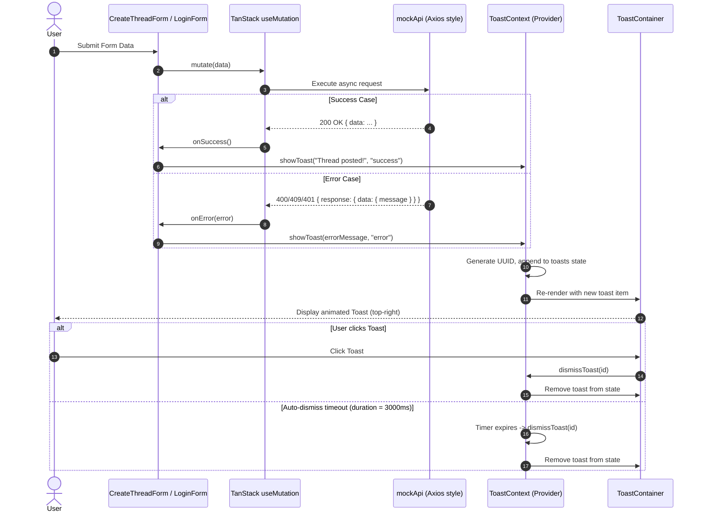

# High-Level Design (HLD)

## Project: Threadbase Toast Notification System

---

### 1. Architecture Overview

The Threadbase Toast Notification System is architected around the **React Context Pattern**, combined with a **Singleton-like Provider & Container model**. This architecture decouples notification triggering from notification rendering, allowing any deeply nested component to emit notifications without prop-drilling or external dependency overhead.

```
+-----------------------------------------------------------------------+
|                                App                                    |
|                                                                       |
|  +-----------------------------------------------------------------+  |
|  |                         ToastProvider                           |  |
|  |  [State: toasts = [{id, message, type, duration}, ...]]         |  |
|  |  [Methods: showToast(), dismissToast()]                        |  |
|  |                                                                 |  |
|  |  +-------------------------+     +---------------------------+  |  |
|  |  |    Application Tree     |     |      ToastContainer       |  |  |
|  |  |                         |     |  (Fixed Top-Right)        |  |  |
|  |  |  +-------------------+  |     |                           |  |  |
|  |  |  | CreateThreadForm  |  |     |  +---------------------+  |  |  |
|  |  |  +-------------------+  |     |  | Toast 1 (Success)   |  |  |  |
|  |  |  | LoginForm         |  |     |  +---------------------+  |  |  |
|  |  |  +-------------------+  |     |  | Toast 2 (Error)     |  |  |  |
|  |  +-------------------------+     +---------------------------+  |  |
|  +-----------------------------------------------------------------+  |
+-----------------------------------------------------------------------+
```

---

### 2. Component Hierarchy & Flow Diagram

```mermaid
flowchart TD
    subgraph UI ["User Interface"]
        CTF["CreateThreadForm"]
        LF["LoginForm"]
    end

    subgraph ContextLayer ["Context & State Management"]
        TP["ToastProvider (ToastContext)"]
        State["toasts: Array<Toast>"]
        Show["showToast(message, type, duration)"]
        Dismiss["dismissToast(id)"]
    end

    subgraph AsyncLayer ["Asynchronous API / Network"]
        RQ["TanStack Query (useMutation)"]
        MockAPI["Mock Axios API (createThread / login)"]
    end

    subgraph Presentation ["Presentation Layer"]
        TC["ToastContainer (Fixed Position)"]
        ToastItem["Individual Toast Elements (.toast)"]
    end

    CTF -->|mutate| RQ
    LF -->|mutate| RQ
    RQ -->|call| MockAPI
    MockAPI -->|resolve / reject| RQ

    RQ -->|onSuccess / onError| Show
    Show -->|crypto.randomUUID() & append| State
    Show -->|setTimeout(dismissToast)| Dismiss

    TP -->|provides| TC
    State -->|mapped into| TC
    TC -->|renders| ToastItem
    ToastItem -->|onClick| Dismiss
    Dismiss -->|filter out toast by id| State
```

---

### 3. End-to-End Sequence of Interactions



---

### 4. Component Responsibilities

| Component / Module | Responsibility |
|---|---|
| **`ToastContext.jsx`** | Central authority for notification state. Manages the active toasts array, exposes `showToast` and `dismissToast` methods via React Context, and schedules auto-dismiss timers. |
| **`ToastContainer.jsx`** | Presentational viewport container positioned in a fixed coordinate space (top-right). Renders individual toasts, binds dismiss interactions, and assigns accessibility roles. |
| **`useToast` Hook** | Custom consumer hook providing convenient and safe access to `ToastContext`, verifying presence inside a `ToastProvider` boundary. |
| **`CreateThreadForm.jsx`** | Handles thread creation inputs and wires mutation responses (`onSuccess`, `onError`) to appropriate toast dispatches. |
| **`LoginForm.jsx`** | Handles user login inputs and dispatches feedback toasts based on credential resolution. |
| **`mockApi.js`** | Mock server implementation simulating latency and standardized HTTP/Axios response and error envelopes. |

---

### 5. Architectural Decisions (ADRs)

#### ADR 1: React Context API over External State Stores (Redux / Zustand)
- **Context:** Toasts are transient UI states that do not require complex persistence, normalized caching, or heavy middleware.
- **Decision:** Utilize native React `createContext` and `useState`.
- **Consequences:** Zero external dependencies, minimal bundle size, and effortless consumption across components.

#### ADR 2: Centralized Container within Provider Root
- **Context:** Toasts must display on top of all page elements without stacking context or `overflow: hidden` clipping issues.
- **Decision:** Mount `<ToastContainer />` directly inside `<ToastProvider>`, rendered once at the top of the app tree.
- **Consequences:** Consistent top-right coordinate placement without requiring manual portal plumbing.

#### ADR 3: State Updater Functions with Memoized Callbacks
- **Context:** `showToast` and `dismissToast` are passed to callbacks and timers that can encounter stale closures.
- **Decision:** Use updater functions: `setToasts((prev) => prev.filter(...))` and wrap `dismissToast` in `useCallback([], [])`.
- **Consequences:** Eliminates stale closure bugs and keeps callback references stable across re-renders.

---

### 6. Reliability, Performance & Accessibility

- **Memory Safety:** When `dismissToast` is invoked, the target item is removed from the array. Even if a timeout triggers after early click dismissal, the immutable filter is idempotent and safe.
- **Accessibility:** The container applies `role="status"` which maps to polite ARIA live regions, ensuring screen readers announce messages without interrupting ongoing speech.
- **Responsive Layout:** Responsive layout limits container width to `320px` with fixed spacing, adapting gracefully to mobile viewports.
