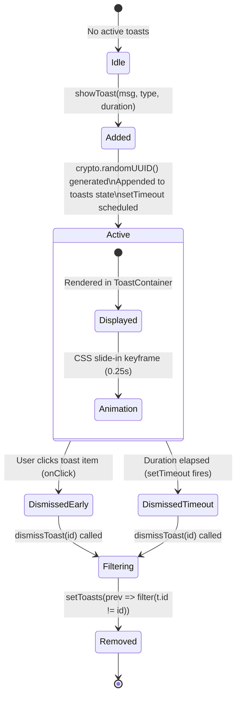

# Low-Level Design (LLD)

## Project: Threadbase Toast Notification System

---

### 1. Data Models and Type Contracts

#### 1.1 `Toast` Entity Structure
```typescript
interface Toast {
  id: string;                                    // Unique identifier generated via crypto.randomUUID()
  message: string;                               // User-facing notification text
  type: "info" | "success" | "error";            // Visual style category
  duration: number;                              // Lifetime in milliseconds before auto-dismiss
}
```

#### 1.2 `ToastContextValue` Contract
```typescript
interface ToastContextValue {
  showToast: (message: string, type?: "info" | "success" | "error", duration?: number) => void;
  dismissToast: (id: string) => void;
}
```

---

### 2. Module Specifications

#### 2.1 `ToastContext.jsx`

##### State:
- `toasts`: `Toast[]` initialized to `[]`.

##### Core Functions:

- **`dismissToast(id: string): void`**
  - **Purpose:** Removes a toast by its unique ID.
  - **Optimization:** Wrapped in `useCallback` with empty dependencies `[]`.
  - **Implementation:**
    ```javascript
    const dismissToast = useCallback((id) => {
      setToasts((prev) => prev.filter((toast) => toast.id !== id));
    }, []);
    ```

- **`showToast(message: string, type = "info", duration = 3000): void`**
  - **Purpose:** Spawns a new toast, adds it to the queue, and sets an auto-dismiss timer.
  - **Optimization:** Wrapped in `useCallback` with `[dismissToast]` dependency.
  - **Implementation:**
    ```javascript
    const showToast = useCallback(
      (message, type = "info", duration = 3000) => {
        const id = crypto.randomUUID();
        setToasts((prev) => [...prev, { id, message, type, duration }]);
        setTimeout(() => {
          dismissToast(id);
        }, duration);
      },
      [dismissToast]
    );
    ```

- **`useToast(): ToastContextValue`**
  - **Purpose:** Custom hook allowing child components to consume context.
  - **Boundary Check:** Throws `Error("useToast must be used inside a ToastProvider")` if accessed outside `<ToastProvider>`.

---

#### 2.2 `ToastContainer.jsx`

##### Props:
- `toasts: Toast[]`
- `onDismiss: (id: string) => void`

##### Rendering Logic:
- If `toasts` is empty or undefined, returns `null` or empty container.
- Container element: `<div className="toast-container" role="status">`
- Child mapping:
  ```jsx
  {toasts.map((toast) => (
    <div
      key={toast.id}
      className={`toast toast-${toast.type}`}
      onClick={() => onDismiss(toast.id)}
    >
      {toast.message}
    </div>
  ))}
  ```
- Attributes:
  - `key`: `toast.id` (stable key for React reconciliation).
  - `role="status"`: Announces toasts to screen readers without interrupting.
  - `onClick`: Triggers immediate dismissal via `onDismiss(toast.id)`.

---

#### 2.3 Form Integration: `CreateThreadForm.jsx`

##### Mutation Handling:
```javascript
const mutation = useMutation({
  mutationFn: createThread,
  onSuccess: () => {
    showToast("Thread posted!", "success");
  },
  onError: (error) => {
    const message = error?.response?.data?.message || "Failed to post thread";
    showToast(message, "error");
  },
});
```

##### Input Reset:
- Resets form state `title` to `""` on submit to allow immediate subsequent input.

---

#### 2.4 Form Integration: `LoginForm.jsx`

##### Mutation Handling:
```javascript
const mutation = useMutation({
  mutationFn: login,
  onSuccess: () => {
    showToast("Welcome back!", "success");
  },
  onError: (error) => {
    const message = error?.response?.data?.message || "Invalid username or password";
    showToast(message, "error");
  },
});
```

---

### 3. Toast Lifecycle & State Transitions



---

### 4. CSS Specification & Visual Mapping

| Class Name | Applied To | CSS Properties / Behavior |
|---|---|---|
| `.toast-container` | Wrapper `<div>` | `position: fixed; top: 1rem; right: 1rem; z-index: 9999; display: flex; flex-direction: column; gap: 0.5rem; max-width: 320px;` |
| `.toast` | Toast card | `padding: 0.75rem 1rem; border-radius: 8px; cursor: pointer; box-shadow: 0 4px 12px rgba(0, 0, 0, 0.12); font-size: 0.9rem; animation: toast-in 0.25s ease;` |
| `.toast-success` | Type modifier | `background: #ecfdf5; border-left: 4px solid #10b981; color: #065f46;` |
| `.toast-error` | Type modifier | `background: #fef2f2; border-left: 4px solid #ef4444; color: #7f1d1d;` |
| `.toast-info` | Type modifier | `background: #eff6ff; border-left: 4px solid #3b82f6; color: #1e3a5f;` |

---

### 5. Edge Cases & Resilience

| Scenario | Handled By | Outcome |
|---|---|---|
| **User clicks toast before auto-dismiss timer expires** | Idempotent `dismissToast(id)` | Toast is removed immediately. When `setTimeout` eventually triggers, `filter` finds no match and state remains consistent without errors. |
| **Rapid successive clicks trigger multiple toasts** | `crypto.randomUUID()` | Each toast receives a distinct unique identifier. Stacks vertically via Flexbox without key collision. |
| **API rejects without an error message in payload** | Fallback string evaluation | `error?.response?.data?.message \|\| "Generic error message"` ensures toast always has informative text. |
| **Component calls `useToast` outside `<ToastProvider>`** | Provider context validation | Explicit error thrown: `"useToast must be used inside a ToastProvider"`. |

---

### 6. Verification and Test Suite

| Test Case | Steps | Expected Result |
|---|---|---|
| **TC-1: Successful Thread Creation** | Input "My First Thread" and submit. | Green toast appears with `"Thread posted!"` and disappears after 3 seconds. |
| **TC-2: Duplicate Thread Error** | Input `"Welcome to Threadbase"` and submit. | Red toast appears with `"A thread with this title already exists"`. |
| **TC-3: Successful Authentication** | Input `ada` / `password` and submit. | Green toast appears with `"Welcome back!"`. |
| **TC-4: Failed Authentication** | Input `invalid` / `wrongpass` and submit. | Red toast appears with `"Invalid username or password"`. |
| **TC-5: Click to Dismiss** | Trigger any toast and click it within 1 second. | Toast immediately disappears from screen without waiting for 3s timer. |
| **TC-6: Stacking Verification** | Rapidly submit form 3 times. | 3 toasts stack neatly in top-right corner without overlapping. |

